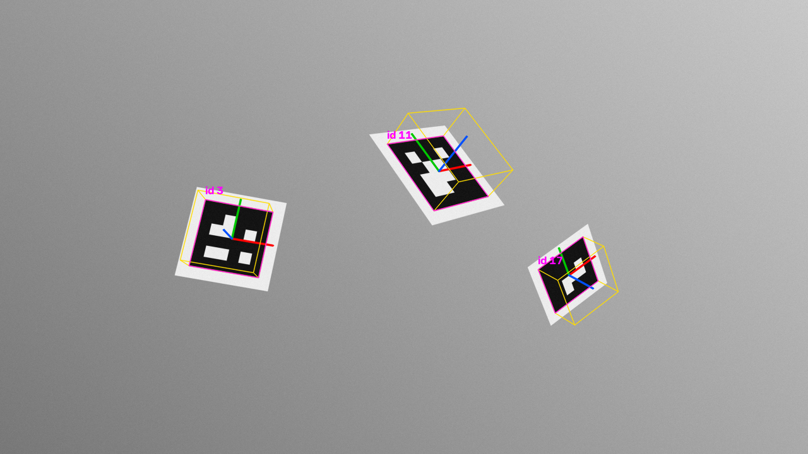
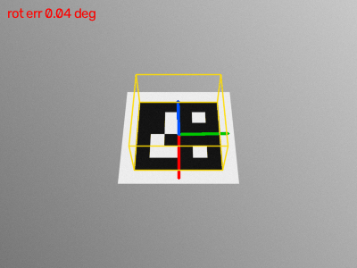

# cv-marker-pose

Square fiducial markers from first principles: a procedural pinhole renderer, a detector
that decodes marker ID **and** orientation, and a 6-DoF pose estimator written from scratch
(normalised DLT homography → decomposition → Levenberg-Marquardt on SE(3) with an analytic
Jacobian). Every image is generated with a known camera and a known ground-truth pose, so
the accuracy claims below are measured, not assumed.





## How it works

| Stage | File | What happens |
|---|---|---|
| Dictionary | `markerpose/marker.py` | Greedy search over all 2^16 payloads for 4×4 codes whose Hamming distance is ≥ 4 from *every rotation* of every other code and of themselves, so a decoded grid pins down both ID and which way up the marker is. Single-bit errors are corrected. |
| Rendering | `markerpose/marker.py` | The plane→image homography `K [r1 r2 t]` warps the marker texture at 4× supersampling, then area-averages down, so edges are anti-aliased and corners land where the pinhole model says. Pixel-centre conventions are handled explicitly. Gaussian sensor noise is added. |
| Detection | `markerpose/detect.py` | Adaptive threshold → contours → convex quads → perspective-unwarp → Otsu → sample cells → reject if the border is not black → dictionary lookup with rotation → reorder corners to texture TL,TR,BR,BL → `cornerSubPix`. |
| Pose | `markerpose/pose.py` | Hartley-normalised DLT for H; `K⁻¹H ≈ λ[r1 r2 t]`, scale by the mean column norm, force `t_z > 0`, complete `r3 = r1×r2`, project to SO(3) by SVD; then LM with left-multiplicative `R ← exp([ω]ₓ)R` updates and the analytic projection Jacobian. Rodrigues exp/log maps are implemented directly (stable near 0 and π). |

OpenCV is used for image plumbing (threshold, contours, warps, sub-pixel corners) and as an
**independent reference** in the tests (`solvePnP` IPPE_SQUARE + `solvePnPRefineLM`,
`cv2.Rodrigues`). It is not used to compute the pose.

## Run it

```bash
pip install -r requirements.txt
python3 demo.py                 # writes output/detection.png, output/distance_sweep.csv, output/orbit.gif
python3 -m unittest -v          # or: pytest
```

## Sample output (pasted from an actual run)

```
Scene: 1280x720, f=1000 px, marker side 12 cm, noise sigma 2 DN
 id corner err px rot err deg trans err mm reproj px vs OpenCV deg vs OpenCV mm
  3         0.203       0.099         1.82    0.0049      2.15e-05     8.35e-05
 11         0.233       0.134         1.19    0.0073      2.06e-06     2.22e-05
 17         0.195       0.194         3.22    0.0182      7.68e-06     8.24e-05
detected 3/3 markers

Distance sweep: 640x480, f=700 px, 10 cm marker, 40 deg oblique, 8 noise seeds per distance
dist m side px detect med rot deg med trans %
   0.3   233.3   8/8        0.036       0.067
   0.5   140.0   8/8        0.076       0.121
   0.8    87.5   8/8        0.130       0.159
   1.2    58.3   8/8        0.196       0.278
   1.6    43.8   8/8        1.433       0.683
   2.0    35.0   8/8        2.681       0.119

Orbit: 36 frames at 55 deg elevation, worst rotation error 0.228 deg

wrote output/detection.png, output/distance_sweep.csv, output/orbit.gif
```

"vs OpenCV" is the disagreement between this pose and OpenCV's refined pose on the *same
detected corners*: ~1e-5 degrees and ~1e-4 mm, i.e. both solvers land on the same
reprojection-error minimum. Errors against ground truth come from the corner detector
(~0.2 px), not the solver.

The distance sweep shows the textbook failure mode of small planar targets: once the
marker spans fewer than ~50 px the projection is close to affine and the **rotation**
becomes ill-conditioned (1–3° median) while translation stays well under 1%.

## Tests

16 tests, all with expected values that come from somewhere other than this code:

- **Hand-computed:** a 90° z-rotation matrix; a scale-2 + shift homography; the frontal
  pose of a 10 cm marker at 0.5 m projecting to ±80 px at f = 800.
- **Exact recovery:** noise-free corners from 25 random poses → rotation within 1e-6°,
  translation within 1e-9 m; LM from a 5°/4 cm-perturbed start converges to the truth.
- **Independent solver:** on noisy corners our pose's reprojection error is never worse than
  OpenCV's optimum, and the two agree within 0.05° / 0.1 mm. `rodrigues` matches
  `cv2.Rodrigues` to 1e-12.
- **Dictionary invariants:** exhaustive check of the ≥ 4 rotation-aware Hamming distance.
- **Rendered images:** all four in-plane orientations, a 55° tilt and a two-marker scene are
  detected with the right ID, corners within 0.5 px of ground truth, rotation error < 1°
  and translation error < 1%; a pure-noise image yields no detections.

```
----------------------------------------------------------------------
Ran 16 tests in 0.256s

OK
```

A real bug the tests caught: the rotation-error metric originally used `arccos`, whose
resolution near zero is ~sqrt(machine eps) rad ≈ 1e-6°, so exact-recovery tests failed at
1.2e-6°. It now uses `atan2(sin θ, cos θ)` of the relative rotation.

Verified on Linux, Python 3.10.12, numpy 2.2.6, opencv-python 5.0.0, Pillow 12.3.0.

## License

MIT
